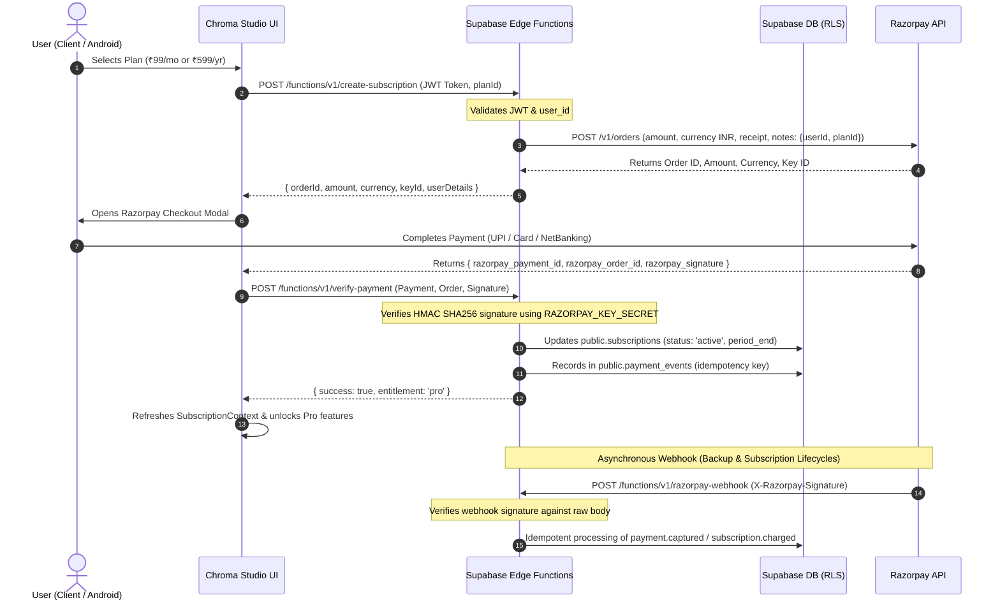

# Chroma Studio — Pro Subscription & Razorpay Integration Audit

**Date:** 2026-11-05  
**Version:** 1.0.0  
**Status:** Audit Completed & Architectural Specification  

---

## 1. Existing System Audit

### 1.1 Authentication & User Profiles
- **Authentication**: Supabase Auth handles email/password, phone OTP, and Google OAuth with native Android deep-linking (`studio.chroma.photoeditor://auth/callback`).
- **User Profile**: `public.profiles` table stores user metadata (`id`, `email`, `full_name`, `username`, `avatar_url`, `bio`, `website`, `role`, `created_at`, `updated_at`).
- **Current State**: The `role` column in `public.profiles` defaults to `user`. There is no dedicated subscription tracking table or payment event log.
- **Client Session**: Managed via `AuthContext.tsx` with `user`, `profile`, and `refreshProfile()`.

### 1.2 Database Schema & Storage
- **Existing Tables**:
  - `public.profiles`: User account details, protected by Row Level Security (RLS) (`auth.uid() = id`).
  - `public.projects`: User project metadata and serialized document state, protected by RLS (`auth.uid() = user_id`).
- **Storage Buckets**:
  - `avatars`: Public read, authenticated user folder upload.
  - `projects`: Private read/write restricted to authenticated user folder (`(storage.foldername(name))[1] = auth.uid()::text`).
- **Missing Tables**: No `subscriptions` table and no `payment_events` table currently exist.

### 1.3 AI Features & Edge Functions
- **Deployed Supabase Edge Functions**:
  1. `ai-assistant`: Natural language color grading & tone adjustment plans.
  2. `ai-enhance`: 1-click photo enhancement with dynamic exposure, shadow recovery, and color balance.
  3. `ai-inpaint`: Object removal and texture reconstruction.
  4. `ai-segmentation`: Cutout and foreground mask extraction.
  5. `ai-background-gen`: Text-to-backdrop synthesis.
  6. `ai-image-gen`: Text-to-image synthesis (DALL-E 3 / Gemini vision).
  7. `ai-preset-rec`: Photometric analysis and smart preset ranking.
- **Current Security Status**: Currently uses in-memory IP rate-limiting, but lacks server-side subscription entitlement verification. Paid APIs can be called by any client possessing the anon key.

### 1.4 Existing UI Entry Points & Placeholders
- **Upgrade Prompts**:
  - `UpgradeProCard.tsx` on `HomeDashboard.tsx`: Displays storage usage and an "Upgrade Now" call-to-action leading to user profile.
  - `NavigationDrawer.tsx`: Sidebar drawer includes an "Upgrade to Pro" card.
  - `ProfileModal.tsx` (`activeTab === 'subscription'`): Contains a mockup card displaying "$9.99/mo" with placeholder alert.
- **Existing Payment Code**: Zero live payment processing code. Razorpay SDK is not yet installed or integrated.

---

## 2. Free vs. Pro Feature Matrix

To protect free-tier usability while delivering tangible value for paid subscribers, we establish the following entitlement boundary:

| Capability | Free Tier (Always Free) | Chroma Studio Pro (₹99/mo or ₹599/yr) | Gating Mechanism |
| :--- | :--- | :--- | :--- |
| **Core Photo Editor** | 100% Unrestricted (Exposure, Contrast, Curves, HSL, Crop, Rotate) | 100% Unrestricted + 32-bit precision pipeline | Client & Engine |
| **Effects & Looks** | 8 Classic Presets & basic effects (Vignette, Grain, Sharpen, Blur) | All standard + Exclusive Pro Looks (Midnight Cinema, Analog Portra, Noir Pro) | Client entitlement check |
| **AI Assistant** | 5 editing plans / day | Unlimited natural language AI edits | Server Edge Function check |
| **AI Image Enhancement** | Standard preview | Cloud AI Deep Multi-Zone Lighting & Facial Protection | Server Edge Function check |
| **AI Object Removal** | Up to 3 object removals / day | Unlimited AI Generative Inpainting | Server Edge Function check |
| **AI Background Removal** | Standard cutout & transparent PNG export | Ultra-precise edge segmentation & alpha matting | Server Edge Function check |
| **AI Background Replacement** | Solid colors & uploaded local photos | Solid colors, local photos + AI Generative Scene Backdrops | Server Edge Function check |
| **AI Text-to-Image Generation** | 3 preview generations / month | 50 high-res generations / month + all aspect ratios | Server Edge Function check |
| **Smart Preset Recommendations** | Heuristic rule-based recommendations | Multimodal AI Vision analysis & confidence match scores | Server Edge Function check |
| **Cloud Projects & Storage** | Up to 3 active cloud projects (100 MB) | Unlimited cloud projects & 10 GB high-speed cloud storage | Supabase RLS / Service check |
| **Export Quality** | Standard HD (1080p, 85% JPEG/PNG) | Full Original Resolution & Ultra 4K (Lossless PNG, WebP 100%, 300 DPI) | Client & Canvas pipeline |
| **Templates & Carousels** | Starter templates | All 100+ Pro templates, carousels, and priority assets | Client catalog check |

---

## 3. Subscription Plans & Pricing (INR)

- **Pro Monthly**: **₹99 / month**
  - Billed monthly.
  - Full access to all Pro features.
  - Cancel anytime.
- **Pro Yearly**: **₹599 / year** (~₹49.90 / month, **50% savings**)
  - Billed annually.
  - Full access to all Pro features + 10GB cloud storage.
  - Priority support and early access to new AI models.

---

## 4. Technical Architecture & Security Model

### Security Guardrails:
1. **Zero Secret Exposure**: `RAZORPAY_KEY_SECRET` and `RAZORPAY_WEBHOOK_SECRET` reside exclusively in Supabase Vault / Edge Function secrets.
2. **Never Trust Client-Side Success**: The frontend checkout handler is considered untrusted until the server-side Edge Function verifies the cryptographic HMAC SHA-256 signature.
3. **Database RLS**: Clients have `SELECT` access only on their own subscription row (`auth.uid() = user_id`). Direct `INSERT`, `UPDATE`, or `DELETE` on subscriptions is completely revoked from `anon` and `authenticated` roles. Only `service_role` (Edge Functions) can modify subscriptions.
4. **Idempotency**: All payment IDs and webhook event IDs are logged in `public.payment_events` with unique constraints, preventing double-crediting or duplicate activations.
5. **Server-Side AI Gating**: Protected Edge Functions check the user's active subscription status in `public.subscriptions` before making upstream calls to Gemini or OpenAI.
