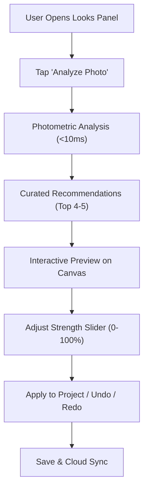

# Chroma Studio — Smart Preset Recommendations Audit & Technical Specification

**Date:** November 1, 2026  
**Status:** In Progress — Implementation Phase  
**Scope:** Intelligent photometric image analysis, rule-based and cloud AI preset recommendations, non-destructive preview & intensity blending, and UI integration in the Looks Studio.

---

## 1. Executive Summary & Existing Preset Architecture Audit

Chroma Studio possesses an extensive, production-grade preset and color grading architecture:

| System / Subsystem | Current State | Compatibility & Integration Path |
| :--- | :--- | :--- |
| **Preset Library** | `src/data/presets.ts` has 40+ presets categorized across 11 genres (Cinematic, Portrait, Vintage Film, Black & White, Golden Hour, Moody, Pastel, Travel, Food, Street, Social Media). | **100% Reusable.** Each preset defines target parameters (`AdjustmentParameters`), split-toning color wheels (`ColorWheels`), tone curves (`ToneCurves`), and HSL mixer values (`HslAdjustments`). |
| **Preset Interpolation Pipeline** | `blendPresetAdjustments` in `src/engine/pipeline.ts`. | Smoothly blends preset parameters, wheels, curves, and HSL mixer with base adjustments based on `presetIntensity` (0–100%). At 0%, neutral base adjustments are returned. At 100%, full preset contributions apply. |
| **Image Analysis Capabilities** | `pipeline.ts` already calculates 256-bin RGB and Luminance histograms (`HistogramData`) and extracts dominant color clusters (`DominantColor[]`). | We build an analytical image analyzer (`imageAnalyzer.ts`) that calculates photometric statistics: mean luminance, contrast standard deviation, dynamic range ($p_{99} / p_1$), color temperature (warm/cool ratio), skin-tone chromaticity ratio, and foliage/sky chromaticity. |
| **Editor State & Project Model** | `Project` schema in `src/types/editor.ts` stores `activePresetId` and `presetIntensity`. | Presets are non-destructive metadata layers. The original image pixel buffer is never altered. Full undo/redo tracking is maintained in `historyPast` and `historyFuture`. |
| **Backend & Cloud Architecture** | Supabase Edge Functions on `fbtiigdfglailzjzfryp`. | Deploy `ai-preset-rec` for optional server-side multimodal vision recommendation. When offline or without consent, the client deterministic analyzer provides instant recommendations labeled as **"Analytical Smart Match"**. |

---

## 2. Recommendation Engine Capabilities

### A. Photometric Image Analysis (Deterministic & Real-Time)
The analytical analyzer extracts 10 core metrics from the image:
1. **Mean Luminance ($\mu_L$):** Overall exposure balance (Low-Key $\le 65$, Mid-Key $66\text{–}180$, High-Key $\ge 181$).
2. **Contrast Standard Deviation ($\sigma_L$):** Spread of tone across highlights and shadows.
3. **Dynamic Range ($p_{99} - p_1$):** Clipping margins at shadow and highlight extremes.
4. **Color Temperature Ratio:** $R_{\text{avg}} / B_{\text{avg}}$ balance determining warm vs. cool cast.
5. **Saturation Index:** Average color saturation across pixels (detects monochrome / low-saturation candidates vs. vivid scenes).
6. **Skin-Tone Chromaticity Ratio:** Identifies human portraits ($R > G > B$, Hue $15^\circ\text{–}40^\circ$, Saturation $20\%\text{–}60\%$).
7. **Foliage & Greenery Ratio:** Identifies outdoor nature and landscape photography ($G > R$ and $G > B$, Hue $80^\circ\text{–}150^\circ$).
8. **Sky / Atmospheric Horizon Ratio:** Identifies sky and open landscapes.
9. **Golden Hour Score:** High warm highlight concentration combined with high dynamic range.
10. **Urban / Architectural Contrast:** High acutance, midtone contrast, and neutral cast.

### B. Rule-Based Matching Heuristics
- **Skin-Tone Dominated ($\ge 15\%$ skin pixels):** Recommends *Portrait Classic*, *Studio Warmth*, or *Editorial Glow*. Explanation: *"Human portrait chromaticity detected. 'Portrait Classic' softens harsh highlights while enhancing natural skin warmth."*
- **High Warm Highlights & Sunset Horizon:** Recommends *Golden Hour*, *Teal Horizon*, or *Amber Sun*. Explanation: *"Golden hour warm lighting detected. 'Teal Horizon' enriches complementary blue shadows against radiant amber highlights."*
- **Foliage & Nature Dominated:** Recommends *Nordic Chill*, *Emerald Meadow*, or *Vibrant Wanderlust*. Explanation: *"Abundant natural greenery detected. 'Emerald Meadow' balances foliage saturation with crisp midtone clarity."*
- **Low-Key / Moody / Dark Scenes ($\mu_L < 70$):** Recommends *Midnight Cinema*, *Dark Noir*, or *Moody Velvet*. Explanation: *"Low-key moody lighting detected. 'Midnight Cinema' enriches deep shadow depth with subtle atmospheric halation."*
- **Monochrome / Low Saturation ($\text{Sat} < 18$):** Recommends *Silver Halide 400*, *Noir High Contrast*, or *Vintage Monochrome*. Explanation: *"Subdued color palette detected. 'Silver Halide 400' delivers iconic analog black & white tonal depth."*

### C. Transparency & Nomenclature
- When computed client-side via photometric heuristics, the UI is explicitly labeled:  
  **"Analytical Smart Match (On-Device Vision Analysis)"**.
- When enhanced via cloud vision API with user consent, the UI is labeled:  
  **"Cloud AI Vision Match"**.

---

## 3. User Workflow & Non-Destructive Lifecycle

1. **Non-Destructive:** Clicking a recommendation immediately updates the live canvas via `blendPresetAdjustments`. The underlying base adjustments remain intact.
2. **Undo/Redo:** Switching presets or clearing a look records atomic history snapshots.
3. **Save/Reopen:** `activePresetId` and `presetIntensity` persist in IndexedDB and Supabase.
4. **Export:** High-resolution export faithfully reproduces the blended look.
